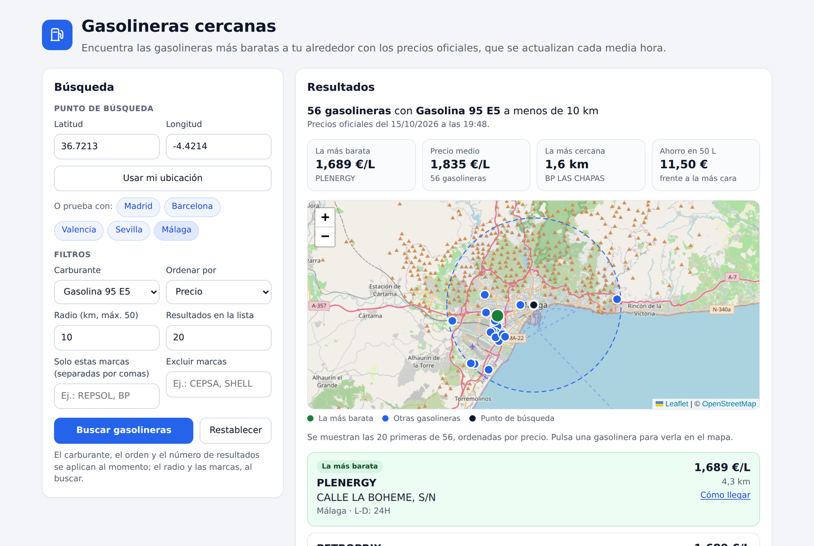

# Gasolineras cercanas

[](https://github.com/AngelorumCSE/gasolineras-cercanas/actions/workflows/ci.yml)

Aplicación web que encuentra las gasolineras más baratas alrededor de un punto de España con los precios oficiales de carburantes, que se actualizan cada media hora.

**Demo:** https://gasolineras-cercanas.vercel.app



## Qué hace

- Busca a partir de unas coordenadas, de la ubicación del navegador o de una ciudad de ejemplo.
- Filtra por carburante, por radio (hasta 50 km) y por marcas, para incluir o excluir las que quieras.
- Ordena por precio o por distancia y destaca la gasolinera más barata y la más cercana.
- Resume cada búsqueda: precio más bajo, precio medio y cuánto se ahorra al llenar 50 L en la más barata frente a la más cara del radio.
- Muestra las gasolineras en un mapa (Leaflet y OpenStreetMap) enlazado con la lista, con un enlace para abrir la ruta en Google Maps.

## Cómo funciona


- **Intermediario por CORS.** La API del Ministerio no permite llamadas desde el navegador, así que una función serverless de Vercel (`api/EstacionesTerrestres.js`) hace la consulta y devuelve solo lo necesario.
- **Descarga por provincias.** El listado de toda España pesa unos 12 MB y tarda 15-20 s. La función calcula qué provincias quedan a menos del radio, con el rectángulo que ocupan sus gasolineras (`lib/provincias.js`), y descarga solo esas. En octubre de 2026, una búsqueda de 10 km en Málaga devolvía 57 gasolineras en unos 1,5 s (20 KB) y una de 50 km en Madrid, 961 gasolineras en unos 2,3 s (300 KB).
- **Caché y errores.** Cada provincia se guarda 10 minutos en memoria y la CDN de Vercel puede reutilizar una respuesta durante 5 minutos. Cada petición al Ministerio tiene un límite de 9 s y, si falla alguna provincia, se devuelve el resto con un aviso.
- **Limpieza de datos.** El frontend convierte la coma decimal de coordenadas y precios y lee claves con tilde como `Dirección`. Ordena y resume en el navegador, así que cambiar de carburante o de orden no vuelve a llamar a la API.
- **Tabla de provincias reproducible.** `npm run provincias` la regenera a partir del listado nacional y descarta las coordenadas erróneas, como (0, 0) o latitud y longitud intercambiadas.

## Tecnologías

React 18 · Vite 5 · Leaflet · Node.js (función serverless en Vercel) · pruebas con `node:test`

## Ejecutar en local

Requisitos: Node.js 18 o superior.

```bash
npm install
npm run dev      # http://localhost:5173 (la ruta /api usa la misma función que Vercel)
npm test         # pruebas unitarias con una API simulada, sin conexión a Internet
npm run build    # versión de producción en dist/
```

## Estructura

```
api/EstacionesTerrestres.js     función serverless (capa HTTP)
lib/estaciones.js               búsqueda por provincias, caché y filtros
lib/provincias.js               rectángulo de cada provincia (archivo generado)
scripts/generar-provincias.mjs  genera lib/provincias.js
src/
  App.jsx                       estado de la búsqueda y resultados derivados
  components/                   InputSection, ResultsSection, StationCard, MapView
  services/fuelApi.js           cliente de /api y lista de carburantes
  utils/                        normalize, ranking, haversine, format
tests/                          pruebas de lib/, de la función y de la ordenación
```

## Datos

Precios del servicio REST del [Geoportal Gasolineras](https://geoportalgasolineras.es/) (Gobierno de España), publicado como [datos abiertos](https://datos.gob.es/es/catalogo/e05068001-precio-de-carburantes-en-las-gasolineras-espanolas). Mapa © colaboradores de [OpenStreetMap](https://www.openstreetmap.org/copyright).

## Autor

Ángel Soler · [github.com/AngelorumCSE](https://github.com/AngelorumCSE)
