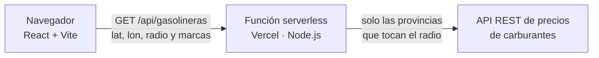

# Gasolineras cercanas

[](https://github.com/AngelorumCSE/gasolineras-cercanas/actions/workflows/ci.yml)
[](https://gasolineras-cercanas.vercel.app)


Aplicación web que encuentra las gasolineras más baratas alrededor de un punto de España con los precios oficiales de carburantes, que se actualizan cada media hora.

**Demo:** https://gasolineras-cercanas.vercel.app


> **English summary.** A React web app that finds the cheapest petrol stations around any point in Spain using the official fuel-price API. A Vercel serverless function proxies the government API (which blocks CORS) and downloads only the provinces that overlap the search radius, cutting a 12 MB national download to about 16 KB for a typical search. Results are sorted by price or distance, summarised (cheapest, average, savings for a 50 L tank) and shown on a Leaflet map. 18 automated tests run on every push with GitHub Actions.

## Qué hace

- Busca a partir de unas coordenadas, de la ubicación del navegador o de una ciudad de ejemplo.
- Filtra por carburante, por radio (hasta 50 km) y por marcas, para incluir o excluir las que quieras.
- Ordena por precio o por distancia y destaca la gasolinera más barata y la más cercana.
- Resume cada búsqueda: precio más bajo, precio medio y cuánto se ahorra al llenar 50 L en la más barata frente a la más cara.
- Muestra las gasolineras en un mapa (Leaflet y OpenStreetMap) y abre la ruta en Google Maps.

## Cómo funciona



- **Intermediario por CORS.** La API del Ministerio no permite llamadas desde el navegador, así que una función serverless de Vercel (`api/gasolineras.js`) hace la consulta y devuelve solo lo necesario.
- **Descarga por provincias.** El listado de toda España pesa unos 12 MB y tarda 15-20 s. La función calcula qué provincias quedan a menos del radio, con el rectángulo que ocupan sus gasolineras (`lib/provincias.js`), y descarga solo esas. En octubre de 2026, una búsqueda de 10 km en Málaga devolvía 57 gasolineras en unos 2 s (16 KB) y una de 50 km en Madrid, 961 gasolineras en unos 2,4 s (260 KB).
- **Datos limpios desde el servidor.** La función convierte la coma decimal de coordenadas y precios, lee claves con tilde como `Dirección` y devuelve cada gasolinera con sus precios ya como números. La web solo ordena y resume, así que cambiar de carburante o de orden no vuelve a llamar a la API.
- **Caché y errores.** Cada provincia se guarda 10 minutos en memoria y la CDN de Vercel puede reutilizar una respuesta durante 5 minutos. Cada petición al Ministerio tiene un límite de 9 s y, si falla alguna provincia, se devuelve el resto con un aviso.
- **Tabla de provincias reproducible.** `npm run provincias` la regenera a partir del listado nacional y descarta las coordenadas erróneas, como (0, 0) o latitud y longitud intercambiadas.

## Cómo leer el código

Cada archivo empieza con un comentario que explica qué hace. En este orden se sigue una búsqueda de principio a fin:

1. `src/App.jsx`: el estado de la página y la función `buscar()`.
2. `src/api.js`: la llamada a `/api/gasolineras`.
3. `api/gasolineras.js` y `lib/gasolineras.js`: la función serverless y la búsqueda por provincias.
4. `src/calculos.js`: la ordenación y el resumen.
5. `src/componentes/`: el formulario, los resultados, la tarjeta de cada gasolinera y el mapa.

## Tecnologías

React 18 · Vite 5 · Leaflet con react-leaflet · Node.js (función serverless en Vercel) · pruebas con `node:test` · GitHub Actions

## Ejecutar en local

Requisitos: Node.js 18 o superior.

```bash
npm install
npm run dev      # http://localhost:5173 (la ruta /api usa la misma función que Vercel)
npm test         # 18 pruebas con una API simulada, sin conexión a Internet
npm run build    # versión de producción en dist/
```

## Estructura

```
api/gasolineras.js              función serverless (lee y comprueba los parámetros)
lib/
  gasolineras.js                búsqueda por provincias, caché, filtros y limpieza de datos
  carburantes.js                lista de carburantes (la usan el servidor y la web)
  provincias.js                 rectángulo de cada provincia (archivo generado)
scripts/generar-provincias.mjs  genera lib/provincias.js
src/
  App.jsx                       estado de la página y búsqueda
  api.js                        llamada a /api/gasolineras
  calculos.js                   ordenación y resumen
  formato.js                    precios, distancias y fechas en formato español
  componentes/                  Busqueda, Resultados, Gasolinera y Mapa
  estilos.css                   estilos
tests/                          pruebas de la búsqueda, de la función y de los cálculos
```

## Datos

Precios del servicio REST del [Geoportal Gasolineras](https://geoportalgasolineras.es/) (Gobierno de España), publicado como [datos abiertos](https://datos.gob.es/es/catalogo/e05068001-precio-de-carburantes-en-las-gasolineras-espanolas). Mapa © colaboradores de [OpenStreetMap](https://www.openstreetmap.org/copyright).

## Autor

Ángel Soler · [github.com/AngelorumCSE](https://github.com/AngelorumCSE)
